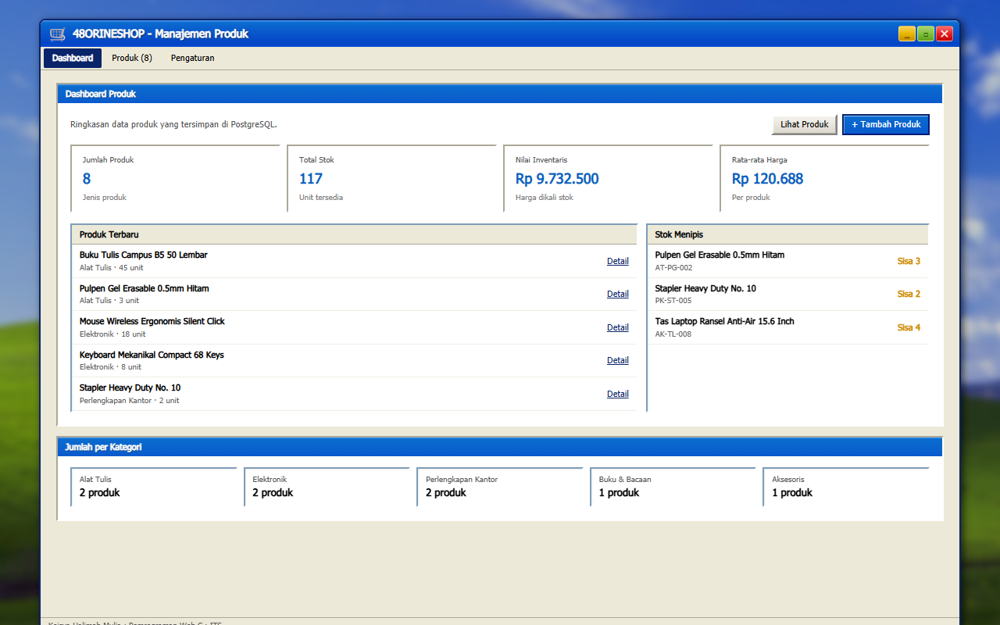
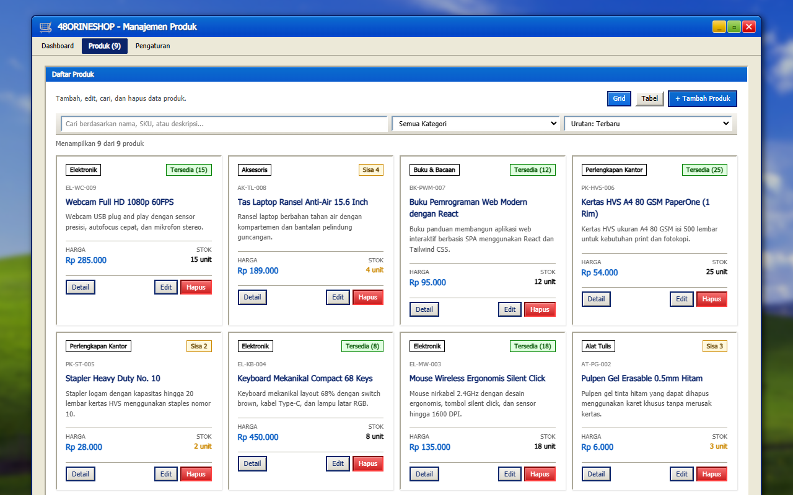

# Tugas 4: React Router, Tailwind CSS, dan Integrasi Express

**Nama:** Keisya Halimah Mulia  
**NRP:** 5027251068  
**Kelas:** Pemrograman Web C

Repository ini berisi frontend aplikasi Manajemen Produk. Aplikasi dibuat
dengan React, React Router v7, dan Tailwind CSS v4, kemudian dihubungkan ke
REST API Express agar data CRUD tersimpan di PostgreSQL melalui Prisma.

Backend tugas ini berada di repository
[pweb-class-express-database-task](https://github.com/keisyaahm/pweb-class-express-database-task).

## Fitur yang Dikerjakan

- Navigasi SPA tanpa full page reload.
- Layout bersama dengan navbar, `Outlet`, dan footer.
- Dashboard ringkasan inventaris dari data API.
- Katalog dengan pencarian, filter, pengurutan, serta mode grid dan list.
- CRUD produk dari React ke Express API dan PostgreSQL.
- Halaman detail dinamis menggunakan `useParams`.
- Halaman produk tidak ditemukan dan fallback route 404.
- Tampilan responsif untuk mobile, tablet, dan desktop.
- Modal dapat ditutup dengan tombol `Escape`.

## Integrasi Frontend dan Backend

```text
React (localhost:5173)
        |
        | fetch REST API
        v
Express (localhost:3000)
        |
        | Prisma ORM
        v
PostgreSQL (Neon)
```

URL backend dibaca dari `VITE_API_URL`. Nilai development pada
`.env.example` adalah `http://localhost:3000`.

| Aksi Frontend | Request API | Hasil |
| --- | --- | --- |
| Membuka aplikasi | `GET /products` | Mengambil produk dari database |
| Menambah produk | `POST /products` | Menyimpan produk baru |
| Mengedit produk | `PUT /products/:id` | Memperbarui produk berdasarkan ID |
| Menghapus produk | `DELETE /products/:id` | Menghapus produk dari database |
| Reset data | `POST /products/reset` | Mengembalikan delapan produk awal |

## Route Aplikasi

| URL | Halaman | Keterangan |
| --- | --- | --- |
| `/` | `DashboardPage` | Statistik dan ringkasan inventaris |
| `/products` | `ProductsPage` | Katalog, pencarian, filter, dan CRUD |
| `/products/:id` | `ProductDetailPage` | Detail produk berdasarkan parameter URL |
| `/settings` | `SettingsPage` | Preferensi grid/list, ekspor, dan reset data |
| `*` | `NotFoundPage` | Fallback untuk URL yang tidak terdaftar |

Seluruh halaman berada di bawah `AppLayout`. Komponen `Outlet` menjadi tempat
halaman anak tampil sehingga navbar dan footer tidak ditulis berulang.

## State dan Persistensi

State bersama berada di `src/App.jsx`, di atas `Routes`:

- `products`: data produk yang dimuat dari Express API.
- `isLoading` dan `apiError`: status komunikasi dengan backend.
- `displayMode`: pilihan grid/list yang disimpan ke `localStorage`.

Data produk tidak memakai `localStorage` sebagai sumber utama. Operasi tambah,
edit, hapus, dan reset dijalankan ke Express API terlebih dahulu, lalu hasilnya
disinkronkan ke state React. Data tetap tersedia setelah reload karena tersimpan
di PostgreSQL.

## Struktur Frontend

```text
src/
|-- components/
|   |-- atoms/          # Badge, Button, Input
|   |-- molecules/      # FormField, ProductCard, StatCard
|   `-- organisms/      # Navbar, grid/list, dan modal
|-- data/
|   `-- initialProducts.js
|-- layouts/
|   `-- AppLayout.jsx   # Layout bersama dan Outlet
|-- pages/
|   |-- DashboardPage.jsx
|   |-- ProductsPage.jsx
|   |-- ProductDetailPage.jsx
|   |-- SettingsPage.jsx
|   `-- NotFoundPage.jsx
|-- services/
|   `-- productApi.js   # Request ke Express API
|-- App.jsx             # Route dan state bersama
|-- main.jsx            # BrowserRouter
`-- index.css           # Tailwind CSS v4
```

Komponen dipisahkan agar tombol, input, kartu, dan modal dapat digunakan kembali
secara konsisten.

## Cara Menjalankan

### 1. Backend

```bash
git clone https://github.com/keisyaahm/pweb-class-express-database-task.git
cd pweb-class-express-database-task
git checkout tugas-4
npm install
npm run db:setup
npm start
```

Backend berjalan di `http://localhost:3000`.

### 2. Frontend

Buka terminal lain:

```bash
git clone https://github.com/keisyaahm/pweb-class-react-tailwind-task.git
cd pweb-class-react-tailwind-task
git checkout tugas-4
npm install
copy .env.example .env
npm run dev
```

Frontend berjalan di `http://localhost:5173`.

Build production dapat diperiksa dengan:

```bash
npm run build
```

## Bukti Pengujian

| No | Skenario | Hasil Aktual | Bukti |
| --: | --- | --- | --- |
| 01 | Membuka dashboard `/` | Statistik dihitung dari produk API | [Dashboard](docs/evidence/01-dashboard.png) |
| 02 | Membuka `/products` | Katalog grid menampilkan produk | [Grid](docs/evidence/02-products-grid.png) |
| 03 | Memilih List Mode | Produk berubah menjadi tabel | [List](docs/evidence/03-products-list.png) |
| 04 | Mencari `pulpen` | Daftar terfilter menjadi satu produk | [Pencarian](docs/evidence/04-search-filter.png) |
| 05 | Submit form kosong | Pesan validasi tampil | [Validasi](docs/evidence/05-modal-tambah-validasi.png) |
| 06 | Menambah Webcam | POST berhasil dan produk tampil | [Tambah](docs/evidence/06-modal-tambah-success.png) |
| 07 | Mengedit produk | Modal berisi data produk terpilih dan PUT berhasil | [Edit](docs/evidence/07-modal-edit.png) |
| 08 | Menghapus produk | Konfirmasi tampil dan DELETE berhasil | [Hapus](docs/evidence/08-modal-hapus-konfirmasi.png) |
| 09 | Membuka `/products/1` | Detail sesuai ID tampil | [Detail](docs/evidence/09-product-detail.png) |
| 10 | Membuka `/products/999` | Pesan produk tidak ditemukan tampil | [ID tidak ada](docs/evidence/10-product-not-found.png) |
| 11 | Membuka URL acak | Fallback 404 tampil | [Route 404](docs/evidence/11-fallback-404.png) |
| 12 | Membuka `/settings` | Status menunjukkan PostgreSQL API | [Settings](docs/evidence/12-settings-page.png) |
| 13 | Viewport 375 x 667 | Layout berubah menjadi mobile | [Mobile](docs/evidence/13-responsive-mobile.png) |
| 14 | Menekan Escape | Modal tertutup tanpa mouse | [Keyboard](docs/evidence/14-keyboard-accessibility.png) |
| 15 | Reload setelah POST | Produk baru tetap ada dari database | [Persistensi](docs/evidence/15-api-persistence-after-reload.png) |





## Verifikasi Otomatis

Pastikan backend aktif di port 3000, lalu jalankan:

```bash
npm run test:capture
```

Perintah tersebut melakukan build, menjalankan aplikasi final, menguji skenario
utama, dan menyimpan screenshot ke `docs/evidence/`. Data demo dikembalikan ke
delapan produk awal setelah pengujian selesai.
